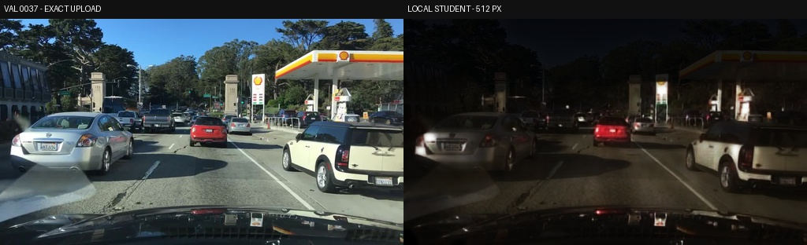
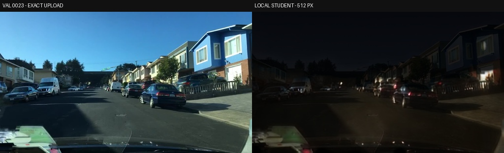
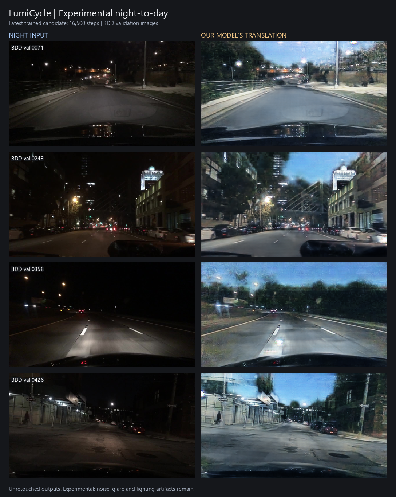

# LumiCycle · Day / Night Image Translation

Turn daytime road photographs into nighttime scenes with a locally trained neural
generator, guided sky repair, and a browser-based GPU demo. An experimental inverse
model also translates night photographs into day.

[Live demo](https://lumicycle-remote-demo.vercel.app/) ·
[Master guide](docs/PROJECT_MASTER_GUIDE.md) ·
[Architecture](FINAL_DAY_NIGHT_ARCHITECTURE.md) ·
[Experiment log](docs/CHANGES.md)


## Real examples

Input on the left, generated image on the right. These are curated BDD100K
validation examples, not a representative accuracy estimate. Predictions are
unretouched; the comparison layout adds labels only.





### Night → Day — experimental

The 16,500-step inverse candidate is available in the site's direction selector.
It has **not passed our visual acceptance gate**: noise, retained headlight glare,
sky artifacts, and inconsistent daylight remain. It is a research preview.



## Features and current architecture

- Local feed-forward inference; no image-generation API is called for translation.
- A 9-block residual RGB generator with channel/spatial attention.
- A separate lightweight sky/vegetation matte network and guided sky compositor.
- Model switching, EMA inference, resumable training and live text monitoring.
- Evaluation tools, reproducible experiments and documented negative results.
- Gradio desktop demo and Vercel interface with a home-PC GPU worker.


**Day → Night default:** RGB student at global step 30,600, followed by a sky
matte model at step 7,800 and guided compositing. The generator has 11,447,541
parameters; the matte network has 1,097,690. The compositor is an explicit
inference repair, not another generator-training run.

**Night → Day preview:** separate 11,447,541-parameter residual generator with
transpose-convolution upsampling, attention and EMA weights, at global step
16,500. It does not use the sky compositor or diffusion sampling.

The figure above describes day-to-night, not the inverse. See
[final architecture](FINAL_DAY_NIGHT_ARCHITECTURE.md),
[inverse experiment plan](docs/NIGHT_TO_DAY_EXPERIMENT_PLAN.md) and
[CARLA auxiliary experiment](docs/NIGHT_TO_DAY_CARLA_STATIC_ABLATION.md).

## Run the demo

### Website + home GPU

Double-click **`start_remote_worker.bat`**, keep its terminal open and prevent the
PC from sleeping. The website's GPU status should turn green. Credentials and
the showcase access code stay outside Git.

Vercel hosts the Next.js interface, uploads and queue. The home PC polls over
outbound HTTPS, generates the selected output on its GPU, and uploads it. No
inbound port or public tunnel is needed. Choose a direction, upload a photograph,
select the model and translate. Night → Day is explicitly experimental.

Setup details: [remote-demo/README.md](remote-demo/README.md).

### Local Gradio

```powershell
.\.venv\Scripts\Activate.ps1
python app.py
```

The existing local Gradio showcase remains day-to-night; the restored inverse
selector is in the remote web interface. Weights are not bundled in Git.

## Install and reproduce

Tested setup: Windows, Python 3.12, CUDA PyTorch, RTX 4070 Super 12 GB, and 32 GB
RAM. CPU inference is slower. Use the pinned setup rather than an arbitrary
CUDA/PyTorch combination.

```powershell
Set-ExecutionPolicy -Scope Process Bypass
.\scripts\setup.ps1
.\.venv\Scripts\Activate.ps1
python -m daynight.doctor
```

Obtain BDD100K images and time-of-day labels after accepting its terms:

```powershell
python -m daynight.prepare_data --bdd-root "D:\datasets\bdd100k"
```

Preparation creates manifests, not copies of the image corpus. Default balanced
splits: 5,000 + 5,000 training, 500 + 500 validation, and 1,000 + 1,000 test.
Duplicate grouping precedes splitting. Validation supports development; keep test
data untouched until final evaluation. Do not redistribute downloaded datasets.
Use E: for large optional caches and follow source-specific licenses.

```powershell
python -m daynight.train --config configs/cyclegan.yaml --max-hours 8 --resume auto
python -m daynight.train --config configs/lumicycle.yaml --max-hours 8 --resume auto
python monitor.py
python -m pytest
python -m daynight.evaluate --checkpoint <checkpoint-path>
```

Atomic checkpoints preserve model/optimizer state, EMA, step and RNG state.
Fine-tuning a changed recipe is not an exact resume; record optimizer resets
and architecture changes. These base commands do **not** reproduce the final
student alone: target generation/distillation and sky-matte training are additional
stages. Follow [the master guide](docs/PROJECT_MASTER_GUIDE.md),
[build diary](PROJECT_PROCESS.md) and [teacher evaluation](docs/REFERENCE_TEACHER_EVALUATION.md)
for the complete lineage.

### Python inference

```python
from PIL import Image
from daynight.inference import translate

output, metadata = translate(
    Image.open("day_scene.jpg"), "day_to_night",
    model_name="LumiCycle distilled student", maximum_edge=512,
)
output.save("night_scene.png")

# Explicit opt-in to the experimental inverse
output, metadata = translate(
    Image.open("night_scene.jpg"), "night_to_day",
    model_name="LumiCycle night-to-day experimental", maximum_edge=512,
)
```

Default weight paths match the project PC. The worker supports
`LUMICYCLE_DISTILLED_STUDENT_CHECKPOINT` and `LUMICYCLE_INVERSE_CHECKPOINT`
overrides. A fresh clone needs licensed data, dependencies and trained weights.

## Experiments and limitations

| Model | Outcome |
|---|---|
| V1, 40k run | Earlier 13k checkpoint was preferable to the final checkpoint. |
| V2 | Improved night appearance; thin sky boundaries remained difficult. |
| V2.1 | Failed ablation: preservation constraints weakened lighting change. |
| LumiRender | Physics-guided experiment mainly learned global darkening. |
| RGB student + sky repair | Current day-to-night default; artifacts remain. |
| Inverse, 16.5k | Research preview; convincing daylight is not reliable. |

Sky repair does not solve every wire, branch, sun or reflection. Outputs can
alter details and must never guide driving or safety decisions. Unseen lights
and occluded details cannot be recovered as ground truth from one photograph.
No state-of-the-art or universal-image claim is made. Curated screenshots do
not replace quantitative evaluation.

## Code and study material

```text
daynight/          Models, inference, training, evaluation and data audits
configs/           Experiment configurations
remote-demo/       Next.js/Vercel site and job API
scripts/           Setup, demo, figure and maintenance tools
tests/             Automated checks
docs/              Architecture, experiment evidence and college guides
```

Start with [PROJECT_MASTER_GUIDE.md](docs/PROJECT_MASTER_GUIDE.md),
[TEAM_STUDY_INDEX.md](TEAM_STUDY_INDEX.md), [viva questions](docs/VIVA.md) and
[visual experiment review](docs/NIGHT_TO_DAY_VISUAL_REVIEW.md).

## Credits and licenses

The deployed RGB student used externally pretrained CycleGAN-Turbo training
targets; inference runs our local student, not that teacher. The inverse retains
historical teacher-target supervision plus CARLA synthetic auxiliary training.
See [credits and provenance](docs/ATTRIBUTION.md) for method references and data
rights. Keep required upstream and dataset notices when redistributing.
