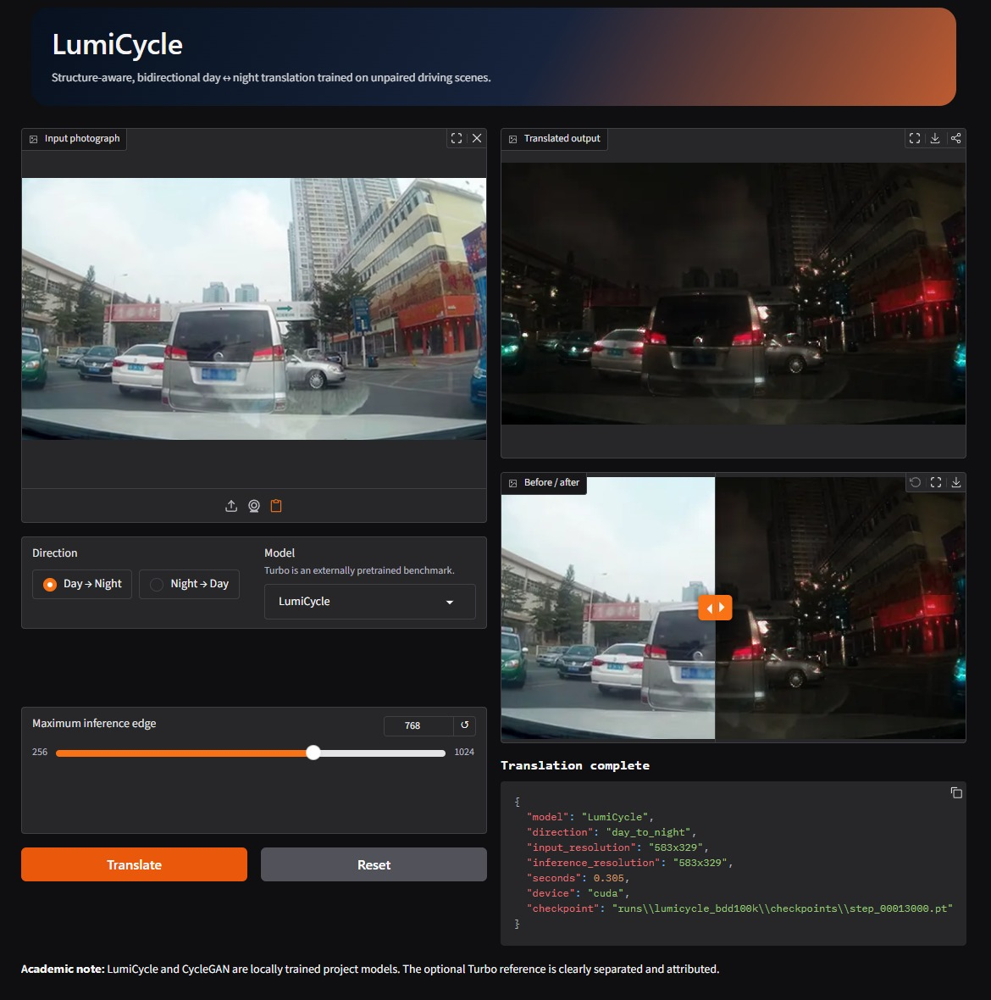
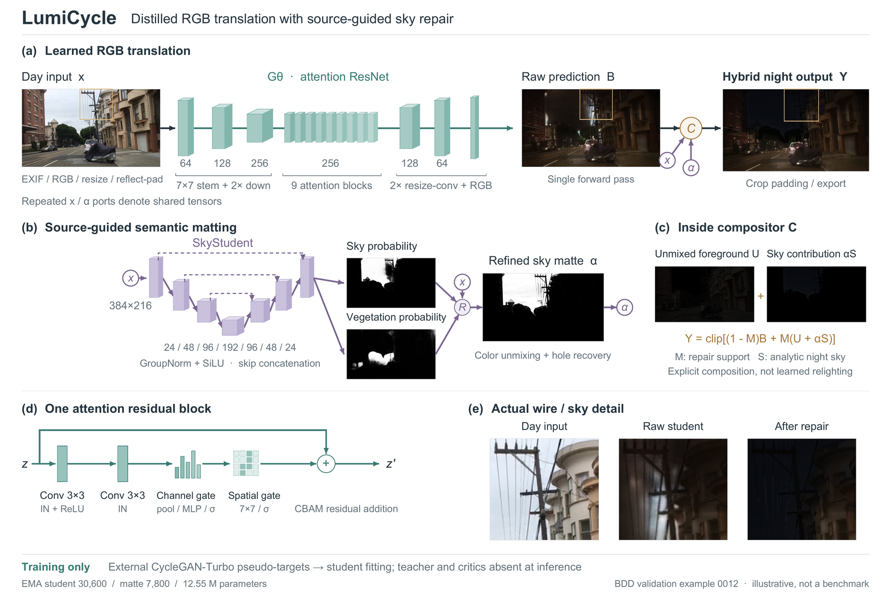

# LumiCycle · Day / Night Image Translation

Locally trained image translation with an upload-based browser demo, home-PC GPU
inference and an offline Gradio interface.

[Live demo](https://lumicycle-remote-demo.vercel.app/) ·
[Showcase setup](SHOWCASE_ONLY.md) · [Credits](CREDITS.md)



## Real examples

Input on the left, model output on the right. These are curated validation
illustrations, not an unbiased performance estimate.


## Current model

The day-to-night default is a feed-forward RGB student at global step 30,600,
followed by a sky/vegetation matte at step 7,800 and guided sky compositing.
The networks contain 12,545,231 learned parameters in total. The separate
16,500-step night-to-day inverse remains experimental: noise, retained glare
and inconsistent daylight are unresolved. Neither direction uses diffusion
sampling or a remote image-generation API during inference.



The local RGB student used external CycleGAN-Turbo pseudo-target supervision.
See [credits](CREDITS.md) for provenance and data rights. Results are plausible
synthesis, not ground-truth relighting or safe driving data.

## Run the existing showcase

On the home GPU PC, double-click **`start_remote_worker.bat`** and keep the PC
awake. Open the live site from any laptop/tablet with internet access. The
college device needs no Python or GPU and need not share the home Wi-Fi.

Vercel hosts the frontend, uploads and queue. The home worker polls over outbound
HTTPS, runs the selected model and uploads the result. Keep access credentials
outside Git.

For local offline day-to-night inference:

```powershell
.\.venv\Scripts\Activate.ps1
python app.py
```

The project PC retains a showcase-only environment and compact inference exports.
All nine remote comparison models remain available. Training datasets, optimizer
states, intermediate checkpoints and research caches are not required for demos.
See [SHOWCASE_ONLY.md](SHOWCASE_ONLY.md) before moving or rebuilding the project.

## Source layout

```text
daynight/        Networks, inference, training, evaluation and data tools
remote-demo/     Next.js/Vercel frontend and job API
configs/         Experiment configurations
scripts/         Setup, export, demonstration and figure tools
tests/           Automated checks
assets/showcase/ Curated examples and architecture preview
```

The source/configuration history is retained for reproducibility. A fresh clone
does not include trained weights or datasets: restore your local inference-weight
backup for the showcase, or prepare licensed data to train again. Tested hardware
is an RTX 4070 Super 12 GB with Python 3.12 and CUDA PyTorch.

```powershell
.\scripts\setup.ps1
python -m daynight.doctor
python -m pytest
```

Private college/research notes are not part of the current public source tree.
Core limitations include fine sky boundaries, remaining light artifacts,
out-of-domain images and invented details. No state-of-the-art claim is made.
