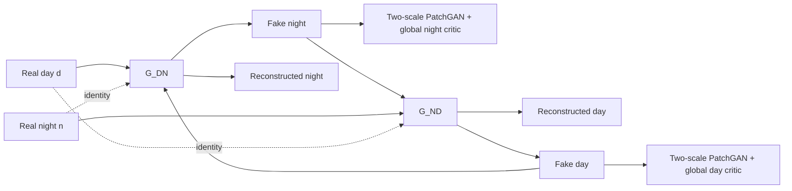
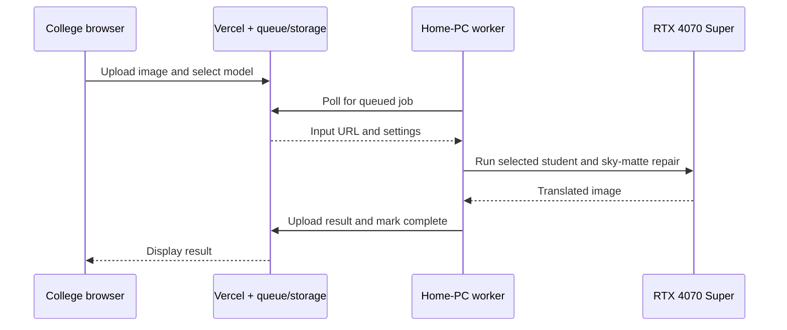

# LumiCycle Master Guide

> Updated **22 October 2026**. The public demo is **Day → Night only** and defaults
> to the **distilled student + integrated sky repair**, not original V2.
> The authoritative architecture snapshot is
> [FINAL_DAY_NIGHT_ARCHITECTURE.md](../FINAL_DAY_NIGHT_ARCHITECTURE.md).
> Original cycle training and V2 details below are explicitly historical.
> Recent experimental night→day work has not changed the day→night model.

## Understand it, defend it, and demonstrate it without bluffing

This is the source-of-truth study guide for the complete Day–Night Image Translation project.
It is deliberately more candid than a promotional report. It explains what the code actually
does, what was borrowed from published ideas, what this team added, which experiment is currently
best, why several later experiments failed, and what claims the evidence does **not** support.

The current showcase model is:

```text
Release:            LumiCycle student + sky repair — experimental
Public direction:   Day → Night only
Local model name:   LumiCycle distilled student
Remote model ID:    distilled_best
Selected generator: E:\LumiCycleCache\experiments\turbo_vgg_target_control\best.pt
Recorded step:      30,600 cumulative; EMA G_day_night
Sky matte:          runs/sky_student_regions_v2/best.pt; step 7,800
Repair version:     2026-10-22-v1
Final student data: 512 × 288 pseudo-pairs from an external Turbo teacher
Demo default:       512 px maximum edge, aspect ratio preserved
Active parameters:  11,447,541 RGB generator + 1,097,690 matte = 12,545,231
Inference:          local student + local matte + explicit image compositing
```

The generator SHA-256 is
`1277b23bda9c13bc4797a19f44fa164000060308b5270a2b436c9b6617ce2185`.
The matte SHA-256 is
`afb481a22ca789880805398e6a00798be4d89450a0c657e10191c7c454032c83`.

Do not call this “V2 5.5k,” original V2 4.5k, or the recent inverse model.
Global 30,600 includes continuation stages with different objectives; it does not
mean 30,600 steps of one unchanged recipe. Best and latest are not interchangeable.

---

## 1. The 90-second explanation

> We turn a daytime photograph into one plausible nighttime interpretation while trying to
> preserve the scene. We began with unpaired BDD100K day/night images and a CycleGAN-style system.
> V1 and V2 taught us that realism and structural preservation can conflict, especially around sky,
> branches, and wires. Later versions did not automatically improve the result.
>
> Our current demo uses a small locally implemented nine-block attention ResNet student. We
> continued trained weights and used outputs from externally pretrained CycleGAN-Turbo as
> pseudo-targets. The student uses resize-convolution upsampling and retains InstanceNorm.
> Its selected EMA weights are cumulative step 30,600. A separate locally trained U-Net predicts
> sky and vegetation; source-guided color unmixing and explicit night-sky compositing repair
> fine sky boundaries. This repair is now integrated, not a separate optional experiment by default.
>
> At inference both learned networks run locally, without the diffusion teacher or discriminators.
> The result is a hybrid learned-and-analytic system, not physically exact relighting. Fine wires,
> sun reflections, light placement, and non-road scenes still fail. Night→day is withdrawn from
> the public interface; ongoing inverse experiments are separate. We acknowledge external teacher
> supervision and do not claim a new state-of-the-art algorithm.

If every teammate can explain that paragraph in their own words, the project will no longer sound
like copied code.

### 1.1 Which algorithm did we use?

CycleGAN is correctly called an algorithm/framework for unpaired image-to-image
translation, not merely a file or dataset. But **“we use CycleGAN” is incomplete for
the current release**. Say: “Our project began with CycleGAN-style learning; the
current day-to-night release uses a teacher-distilled attention ResNet and a
semantic-matte-guided analytic sky correction.” Distinguish the architecture
(network structure), training algorithm/objective, and inference pipeline.

### 1.2 Current architecture to memorize

```text
Day RGB → EXIF/RGB/resize/pad → nine-block CBAM ResNet → raw night RGB
Source  → SkyStudent U-Net → sky/vegetation → guided soft sky alpha
                                         ↓
Raw night + source fine edges + explicit dim sky → final hybrid night image
```

The RGB student has a 7×7 3→64 stem, two stride-2 downsamplers to 128/256,
nine 256-channel attention residual blocks, two nearest-neighbor resize + 3×3
convolution upsamplers to 128/64, and a 7×7 RGB/Tanh head. InstanceNorm remains.
No full-resolution U-Net skip is active in this RGB network.

SkyStudent is the separate U-Net with skip connections: encoder widths 24/48/96,
middle 192, decoder 96/48/24, GroupNorm/SiLU blocks, and two output logits. It runs
at 384×216 internally; its sigmoid maps are upsampled to the inference size.

The compositor recovers nearby sky-colored holes, refines the matte using source
colors, approximately removes mixed daylight sky, and adds a dim blue-gray sky.
Source-derived edges suppress bright wire halos; the integrated foreground exposure
ratio ceiling is 0.12. This is explicit image processing, not a newly trained
end-to-end physical renderer. Wrong masks or color assumptions still cause errors.

### 1.3 Current final training objective, not the original V2 objective

The selected no-VGG control used aligned **generated** source/target pairs:
2,048 training and 48 validation daytime sources, with external Turbo night
pseudo-targets at 512×288. Real corresponding nighttime ground truth was unavailable.

```text
Fidelity = 10 × RGB L1
         + 2 × mean(L1 at 4× and 16× average-pooled scales)
         + mean(horizontal and vertical finite-difference L1)
Total = Fidelity + 0.5 × Highlight + 0.3 × Footprint + 2 × Sky
```

Highlight emphasizes bright teacher pixels; Footprint penalizes incorrect sizes
of bright regions; Sky compares output to the night teacher under a detached local
sky matte. Exact definitions are in the final architecture document. The final
control has **no active GAN, cycle, identity, PatchNCE, DINO, or VGG loss**.
Inherited checkpoint configuration fields are not proof those losses executed.

Final-control settings: Adam LR 1e-4, betas (0.5, 0.999), batch 4, BF16,
gradient clipping 3, EMA 0.99, and paired random horizontal flips. The selected
checkpoint is local update 750 after parent 29,850. Do not confuse this EMA decay
and batch with the historical V2 settings below. Frozen VGG was a separate matched
ablation with small mixed effects, not the selected model's generator or loss.

### 1.4 How to read the historical teaching material

Sections 2–8 teach the original unpaired problem and V2 training system. They are
retained because the team should understand its lineage, **not** because the current
demo trains or executes two generators and critics. Section 9 describes current
inference; section 10 records experiments; section 11 describes current flaws.
For exact current checkpoint identity, loss definitions, and limitations, use
[FINAL_DAY_NIGHT_ARCHITECTURE.md](../FINAL_DAY_NIGHT_ARCHITECTURE.md).

---

## 2. The problem from first principles — original unpaired formulation

### 2.1 What is image-to-image translation?

The input and output are both images, but they belong to different visual domains. Here:

- domain `D` is daytime imagery;
- domain `N` is nighttime imagery;
- `G_DN(d)` should look like night while retaining the scene in daytime image `d`;
- `G_ND(n)` should look like day while retaining the scene in nighttime image `n`.

The task is not normal classification. A classifier outputs a label. Our generator outputs a new
RGB value for every pixel.

### 2.2 Why is it unpaired?

A paired dataset would contain the exact same static scene, camera pose, objects, and weather once
in daylight and once at night. BDD100K does not provide that. Its daytime image and sampled
nighttime image usually show different places and different traffic.

Training therefore observes samples `d ~ p_day` and `n ~ p_night`, but never the correct target
`n_d` for a particular `d`. The desired night appearance is underdetermined: windows may be on or
off, roads may be wet or dry, headlights may appear, and exposure may vary.

This creates two requirements that compete:

1. Change enough appearance to enter the night distribution.
2. Preserve the particular input scene even though no paired target proves what to preserve.

Most of the architecture and losses exist to balance those two requirements.

### 2.3 What is a GAN?

A generator `G` synthesizes an output. A discriminator `D` scores whether an image resembles the
real target domain. During training, `D` becomes better at separating real and generated images;
`G` becomes better at fooling `D`. At inference only `G` is needed.

This adversarial game teaches distribution-level realism, but by itself it does not guarantee that
the generated image depicts the same scene. A generator could create a plausible unrelated night
road. That is why the content-preservation losses are essential.

### 2.4 Why two directions?

The second direction makes cycle consistency possible:

```text
day d   --G_DN--> fake night --G_ND--> reconstructed day d_hat
night n --G_ND--> fake day   --G_DN--> reconstructed night n_hat
```

We penalize `|d_hat - d|` and `|n_hat - n|`. If the scene cannot be reconstructed, one of the
generators discarded or changed too much information.

Cycle consistency is a constraint, not proof of correct translation. The forward generator can
retain or hide information that helps the reverse generator, and both generators can agree on an
unnatural private encoding.

---

## 3. Dataset and leakage control

### 3.1 Original V1/V2 data and the current student subset

The active V1/V2 family uses BDD100K images whose metadata is exactly `daytime` or `night`.

These are the original domain splits. The current student uses the 2,048/48
source subset and external pseudo-target cache described in section 1.3, not
5,000 real aligned day/night pairs. Teacher pretraining overlap with BDD is unknown.

| Split | Day | Night | Purpose |
|---|---:|---:|---|
| Train | 5,000 | 5,000 | Gradient updates |
| Validation | 500 | 500 | Checkpoint selection and plateau detection |
| Test | 1,000 | 1,000 | Final evaluation only |

The preparation report records 42,058 available daytime images and 31,957 available nighttime
images. It found no missing or corrupt selected images. It also flagged extreme exposure and blur
for review rather than silently modifying the held-out test set.

### 3.2 Why duplicate grouping matters

Video-like driving datasets can contain nearly identical adjacent frames. If one frame enters
training and a near duplicate enters test, the test is not truly unseen. The preparation pipeline
uses perceptual duplicate grouping before assigning groups to splits. All members of a group stay
within one split.

The retained audit found no source-filename or exact-dHash overlap between project
train/validation/test partitions. This is not proof against all near-duplicate
video frames: exact hash agreement is narrower than complete sequence-level leakage analysis.

This is one of our direct methodological improvements over any procedure that uses test examples
for architecture selection. Validation data can influence model selection; test data must not.

### 3.3 What an original unpaired V2 training sample looks like

The loader chooses one day image and one independently selected night image. They are not assumed
to align. During training it:

1. fixes EXIF orientation and converts to RGB;
2. resizes the short side to 286 px;
3. takes a random 256 × 256 crop;
4. may flip horizontally;
5. converts values to a tensor normalized to `[-1, 1]`.

At evaluation, the crop is deterministic. The test manifests are not loaded by the trainer.

### 3.4 Why road images limit generalization

BDD100K is dominated by dashcam composition: road below, sky above, buildings and vehicles around
the horizon. V2 can sometimes translate landscapes, but that is incidental generalization. It has
not earned the claim “works on every daytime image.” Indoor scenes, portraits, aerial views, and
unusual compositions are out of distribution.

### 3.5 Research starting point and local environment

The supplied paper, *Unpaired Day-to-Night Image Translation Using Deep Generative Model*, was the
starting brief. We did not reproduce its NAS procedure blindly because using test data during
architecture search would leak evaluation information. The repository instead developed the
CycleGAN baseline and LumiCycle variants with a fixed train/validation/test protocol.

The verified development environment is Windows, Python 3.12.6, PyTorch 2.12.1 with CUDA 13.0,
torchvision 0.27.1, an RTX 4070 Super with 12 GB VRAM, and approximately 32 GB system RAM. Core
Python dependencies also include Pillow, NumPy, PyYAML, TensorBoard, torchmetrics, torch-fidelity,
Gradio, ImageHash, and Requests. Exact CUDA builds matter: installing CPU-only PyTorch would make
the same code run far more slowly even on a computer containing an NVIDIA GPU.

---

## 4. Historical LumiCycle V2 architecture — not the current complete pipeline

### 4.1 System view



There are four main learned networks during training:

- `G_day_night`: day → night;
- `G_night_day`: night → day;
- `D_night`: judges generated versus real night;
- `D_day`: judges generated versus real day.

The generators have the same design but do **not** share weights. The two domain discriminators
also have separate weights.

### 4.2 Generator tensor flow

Each generator is a nine-block ResNet with CBAM attention. For a `B × 3 × 256 × 256` input:

| Stage | Exact operation | Output shape |
|---|---|---|
| Input | RGB normalized to `[-1,1]` | `B×3×256×256` |
| Stem | reflect-pad 3, 7×7 conv 3→64, InstanceNorm, ReLU | `B×64×256×256` |
| Down 1 | 3×3 stride-2 conv 64→128, InstanceNorm, ReLU | `B×128×128×128` |
| Down 2 | 3×3 stride-2 conv 128→256, InstanceNorm, ReLU | `B×256×64×64` |
| Bottleneck | 9 attention residual blocks | `B×256×64×64` |
| Up 1 | 3×3 transposed conv 256→128, InstanceNorm, ReLU | `B×128×128×128` |
| Up 2 | 3×3 transposed conv 128→64, InstanceNorm, ReLU | `B×64×256×256` |
| Head | reflect-pad 3, 7×7 conv 64→3, `tanh` | `B×3×256×256` |

One generator has **11,447,541 parameters**. At inference, day→night loads only the day→night
generator and its exponential-moving-average weights; the critics and inverse generator are not
needed for that request.

### 4.3 Residual block

For input feature tensor `x`, a block computes:

```text
r = InstanceNorm(Conv3x3(ReLU(InstanceNorm(Conv3x3(x))))))
r = CBAM(r)
output = x + r
```

The skip addition lets the block learn a correction to existing features instead of rebuilding
everything. Reflection padding is used to reduce artificial borders compared with zero padding.

### 4.4 CBAM attention

CBAM means Convolutional Block Attention Module. In this code it performs channel attention,
followed by spatial attention.

**Channel attention:** global average and maximum pooling produce two `B×C×1×1` summaries. Both
pass through a shared two-layer 1×1-convolution MLP with reduction ratio 16. Their sum passes
through a sigmoid and multiplies the feature channels.

```text
M_c(x) = sigmoid(MLP(avgpool(x)) + MLP(maxpool(x)))
x_c    = x * M_c(x)
```

**Spatial attention:** channel-wise average and maximum maps are concatenated into two channels.
A 7×7 convolution and sigmoid produce one spatial gate.

```text
M_s(x_c) = sigmoid(conv7x7([channel_mean(x_c), channel_max(x_c)]))
output   = x_c * M_s(x_c)
```

Attention does not know the words “sky,” “road,” or “headlight.” It only learns useful gates from
the training signal. Calling it semantic segmentation would be incorrect.

### 4.5 Local multi-scale discriminator

Each domain has two 70×70-style PatchGANs. One sees the original image; the other sees an
average-pooled half-scale image. Each uses spectral-normalized 4×4 convolutions with approximate
channel progression:

```text
3 → 64 → 128 → 256 → 512 → 1
```

The first three blocks downsample. Later layers slide over overlapping receptive fields. For a
256 px input, the full-scale critic produces roughly a `30×30` map and the half-scale critic a
`14×14` map. Each value judges a region, not one named object.

Why two scales? The full scale sees sharper textures and edges. The half scale sees a larger area
of the original scene per decision, which helps broader lighting patterns.

### 4.6 Global discriminator

V2 adds a whole-frame critic to each domain. It has four spectral-normalized stride-2 convolution
stages, adaptive global average pooling, and a 1×1 output head. It produces one value per image.

PatchGAN can declare every small patch plausible while the whole frame still contains a bright
daytime sky. The global critic was added to judge whether the complete exposure and color balance
are coherent.

Each compound domain discriminator contains **8,284,739 parameters**. Across two generators and
two compound discriminators, V2 trains approximately **39,464,560 parameters**.

### 4.7 Why spectral normalization?

Spectral normalization rescales a layer using an estimate of its largest singular value. It limits
how strongly that layer can amplify a change in its input. In a GAN critic this tends to make the
decision function smoother and the adversarial game less unstable. It is applied to discriminator
convolutions, not to the generator.

---

## 5. Historical V2 losses, exactly and intuitively

The total generator loss is:

```text
L_G = 1.0 L_GAN
    + 10.0 L_cycle
    + 2.0 L_identity
    + 1.0 L_PatchNCE
    + 0.75 L_DINO
    + 2.5 L_edge
    + 0.5 L_color
    + 2.0 L_illumination
```

The numbers are coefficients, not percentages. Raw component magnitudes differ, so a weight of 10
does not automatically mean “ten times more influence” after gradients are considered.

### 5.1 Least-squares GAN loss

For every discriminator output, a generator wants fake predictions to equal one:

```text
L_GAN(G) = mean((D(G(x)) - 1)^2)
```

The discriminator wants real predictions to be one and fake predictions to be zero:

```text
L_D = 0.5 * [mean((D(real)-1)^2) + mean(D(fake)^2)]
```

The code averages over both patch scales and the global critic. LSGAN was chosen instead of a
sigmoid cross-entropy GAN because it gives useful gradients even when a sample is confidently
classified.

### 5.2 Cycle-consistency loss, weight 10

```text
L_cycle = |G_ND(G_DN(d)) - d|_1 + |G_DN(G_ND(n)) - n|_1
```

It preserves recoverable scene content. Its weakness is that it can discourage legitimate large
illumination changes or encourage hidden information.

### 5.3 Identity loss, weight 2

```text
L_identity = |G_ND(d)-d|_1 + |G_DN(n)-n|_1
```

`G_ND` already outputs day, so a real day image should not change much; similarly for `G_DN` and a
real night. V1 used weight 5. V2 reduced it to 2 to give the model more freedom to transform sky
and exposure.

### 5.4 PatchNCE loss, weight 1

Features are taken after the stem, both downsamplers, and residual blocks 1, 5, and 9: six depths
in total. For each level the code samples up to 128 spatial locations. Feature vectors are L2
normalized. The same location in source and translated encodings is the positive pair; other
sampled positions are negatives. Cross entropy uses temperature 0.07.

```text
similarity(i,j) = target_feature_i · source_feature_j / 0.07
correct class for target location i = source location i
```

This encourages a car, pole, or building region to remain represented at the same location. It is
a simplified form: there are no learned CUT-style projection MLPs, and both representations come
from the trainable generator encoder.

### 5.5 DINOv2 semantic loss, weight 0.75

A frozen official `dinov2_vits14` network receives the source and translation, each resized to
224×224 and normalized with ImageNet mean/std. The source feature is detached; gradients flow only
through the translated image and generator.

```text
L_DINO = mean(1 - cosine_similarity(F(source), F(translation)))
```

This protects overall scene meaning. It does not guarantee exact small-object, text, branch, or
wire preservation because the representation is global and only 224 px.

Using a pretrained feature extractor is not the same as using a pretrained translator. DINO
supplies a training loss; it does not generate the final night image and is not needed at
inference.

### 5.6 Sobel edge loss, weight 2.5

Images are converted to grayscale with coefficients `0.299 R + 0.587 G + 0.114 B`. Horizontal and
vertical 3×3 Sobel filters produce a gradient magnitude. L1 distance compares source and output
edge maps.

This protects lanes and boundaries, but grayscale Sobel can miss colored fringes. It may also
penalize valid new light boundaries and reflections.

### 5.7 Color-statistics loss, weight 0.5

For generated output and an unrelated real target image, the code compares:

- mean of R, G, B, and luminance;
- standard deviation of R, G, B, and luminance.

It does not compare unrelated pixels. This teaches broad target-domain tone, but batch-size-one
statistics are noisy and may reward a global tint rather than correct local lighting.

### 5.8 Regional-illumination loss, weight 2

Luminance is average-pooled into three horizontal bands: upper, middle, and lower. Smooth-L1 loss
matches generated band exposure to an unrelated real target image.

For day→night, the code also constructs a soft focus mask from bright source pixels multiplied by
an upper-frame prior that fades to zero by 65% image height. It compares luminance in that region
with target upper-frame luminance. The reverse direction focuses on dark upper-source pixels.

This is why V2 handles many skies better than V1. It is also a major limitation: “bright and high”
is not a true sky label. A bright building, white sign, cloud, or glare can be mistaken for sky.

### 5.9 Why not optimize only adversarial loss?

Then realism has no obligation to preserve the input. Conversely, optimizing only cycle and edge
loss would reproduce the input and avoid becoming night. The problem is the balance, not the mere
presence of many losses.

---

## 6. One historical V2 training iteration

This is the clearest way to prove that you understand the implementation.

1. Load an independent day tensor `d` and night tensor `n`.
2. Generate `fake_night = G_DN(d)` and `fake_day = G_ND(n)`.
3. Re-encode generated images to collect target features for PatchNCE.
4. Reconstruct `recon_day = G_ND(fake_night)` and `recon_night = G_DN(fake_day)`.
5. Run identity paths `G_ND(d)` and `G_DN(n)`.
6. Freeze discriminator gradients while calculating generator adversarial losses.
7. Calculate cycle, identity, PatchNCE, DINO, Sobel, color, and illumination components.
8. Form the weighted generator total and backpropagate divided by accumulation factor 2.
9. Query replay buffers for older generated examples; each domain buffer holds up to 50.
10. Apply differentiable brightness, saturation, and integer-translation augmentation before the
    spatial critics.
11. Calculate real/fake LSGAN discriminator losses.
12. Update discriminators only every second generator optimizer step.
13. After two microbatches, clip generator and discriminator gradient norms to 5.
14. Step Adam optimizers. Generator LR begins at `5e-5`; discriminator LR at `2.5e-5`.
15. Update schedulers and EMA generator shadows with decay 0.999.
16. Every 25 steps, log losses, accuracy, gradient norms, learning rate, variance, and peak VRAM.
17. Every 500 steps, save image grids, validate, and write an atomic checkpoint.
18. If validation stagnates, restore the best weights and halve learning rates once.

### Why replay old generated images?

If the discriminator sees only the generator’s newest outputs, it can chase rapidly changing
artifacts. A replay buffer mixes older fakes into training and slows this oscillation.

### What does DiffAugment do here?

It randomly changes brightness by up to 0.1, saturation from 0.8 to 1.2, and rolls the image by up
to eight pixels. Because these operations are differentiable, generator gradients still pass
through them. The same design can be a weakness: making a critic invariant to brightness and color
is questionable when brightness and color distinguish day from night.

### What does EMA do?

After every generator update:

```text
EMA_new = 0.999 * EMA_old + 0.001 * current_weights
```

Validation and inference use EMA weights. EMA smooths noisy GAN updates; it does not average output
images and does not learn additional parameters.

---

## 7. Historical V2 optimization, checkpointing, and resumption

### 7.1 Training settings

| Setting | V2 value |
|---|---:|
| Seed | 44 |
| Crop | 256 px |
| Physical batch | 1 |
| Gradient accumulation | 2 |
| Precision | BF16 autocast |
| Generator LR | `5e-5` |
| Discriminator LR | `2.5e-5` |
| Adam betas | 0.5, 0.999 |
| D update frequency | once per 2 G steps |
| Warm-up | 250 steps |
| LR decay starts | 8,000 steps |
| Gradient clip | 5.0 |
| Replay size | 50/domain |
| EMA decay | 0.999 |
| Validation/checkpoint | every 500 steps |
| Max planned V2 steps | 12,000 |

Gradient accumulation approximates a batch of two for the optimizer update while retaining the
memory cost of one image pair at a time. It is not perfectly identical to a physical batch of two,
especially because normalization and random augmentation occur per microbatch.

### 7.2 Warm start versus resume

These are different operations:

- **Warm start (`--init-from`)** loads selected model weights into a new experiment. Step count,
  optimizers, schedulers, replay buffers, and usually critics are reset.
- **Resume (`--resume`)** restores the complete saved experiment state and continues its global
  step.

V2 was warm-started from V1 step 13,000 with `init_scope: generators`. It preserved useful
day/night mappings but deliberately did not inherit the saturated V1 critics or exhausted
optimizer schedule. The V2 pilot reached 2,000 steps and the continuation resumed that complete
V2 state.

### 7.3 What is in a checkpoint?

Checkpoint format version 2 stores:

- raw model weights;
- EMA generator weights;
- optimizer and scheduler states;
- replay-buffer contents;
- global step;
- best score, bad-validation count, recovery count, and plateau reductions;
- Python, NumPy, PyTorch, and CUDA random-number-generator states;
- resolved configuration and a configuration hash.

Files are written atomically so a partial write does not replace the previous valid checkpoint.
Keyboard interruption saves once more in a `finally` block.

### 7.4 Why GPU utilization need not remain 99%

The pipeline alternates loading/cropping, CPU-to-GPU transfer, several small network passes,
metrics, logging, validation, and checkpoint writes. Batch one also exposes little parallel work.
Low VRAM or fluctuating utilization does not mean no learning. Increasing batch size improves GPU
occupancy but does not automatically make the model “more intelligent.”

Recorded V2 peak allocated training VRAM was approximately **2.85 GiB** in its TensorBoard run.
That explains why the 12 GB card had headroom; the earlier cloud warning was conservative because
future 384–768 px experiments and heavier teachers can scale memory sharply.

---

## 8. What “best checkpoint” means — historical V2 example

V2 validation ran every 500 steps. The internal score reached its minimum at step 4,500:

| Step | Cycle | Edge | Color | Illumination | Output variance | Score |
|---:|---:|---:|---:|---:|---:|---:|
| 2,500 | 0.1140 | 0.3094 | 0.2812 | 0.0588 | 0.1124 | 0.2629 |
| 4,000 | 0.1084 | 0.3086 | 0.2804 | 0.0578 | 0.1226 | 0.2565 |
| **4,500** | **0.1071** | **0.3118** | **0.2802** | **0.0585** | **0.1228** | **0.25634** |
| 6,500 | 0.1060 | 0.3242 | 0.2784 | 0.0575 | 0.1361 | 0.2576 |
| 12,000 | 0.1051 | 0.3240 | 0.2922 | 0.0623 | 0.1481 | 0.2611 |

At step 6,500, four consecutive validations had failed to improve. The trainer saved a diagnostic,
restored step 4,500 weights, and halved learning rates. Training later reached 12,000, but its score
still did not beat 4,500.

### Critical limitation of the score

The validation formula is approximately:

```text
cycle
+ 0.25 * edge
+ 0.15 * color
+ 0.50 * illumination
+ 0.10 * wavelet
+ 0.25 * self_similarity
```

The last two coefficients come from trainer defaults even though V2 does not list wavelet or
self-similarity as training losses. This is inherited implementation behavior. It does not leak
test data or affect gradient training, but it means checkpoint ranking partly rewards two
structure metrics that were not explicitly recorded in the V2 config.

Therefore:

- “best” means lowest internal validation score, not guaranteed human-preferred output;
- V1 and V2 scores are not automatically comparable if formulas/settings differ;
- the selection should be confirmed by a fixed blind visual suite;
- we currently do not have a complete publication-grade FID/KID and human-preference table.

Never claim that V2 has proven state-of-the-art performance or statistically proven superiority.

---

## 9. Inference and the demo

### 9.1 Local inference path

1. The user uploads an image.
2. EXIF orientation is corrected and the image is converted to RGB.
3. Aspect ratio is preserved while limiting the maximum edge.
4. Dimensions are reflection-padded to a generator-safe multiple.
5. Pixels are normalized to `[-1,1]`.
6. The requested EMA generator runs under inference mode and mixed precision on CUDA.
7. For the selected student, the frozen local sky/vegetation network estimates a
   source-guided matte; integrated compositing repairs sky and thin boundaries.
8. Output is converted back to `[0,255]`, padding is removed, and metadata is returned.

The stable API is:

```python
from PIL import Image
from daynight.inference import translate

output_image, metadata = translate(
    Image.open("input.jpg"),
    "day_to_night",
    model_name="LumiCycle distilled student",
    maximum_edge=512,
    sky_repair=True,
)
output_image.save("night_output.png")
```

The UI explicitly selects student + repair at 512 maximum edge. The bare Python
helper retains legacy defaults of `model_name="LumiCycle"` and maximum edge 768;
explicit arguments above reproduce the current demo rather than that older route.
The selected student was trained at 512×288 in its final stage; original V2 used
256 px crops. Fully convolutional inference permits other dimensions but does not
guarantee equal quality at every scale.

The integrated repair is enabled by default for the student. Missing matte weights
raise an error; they do not silently fall back to raw output. `sky_repair=False`
is an explicit raw-student ablation. Confirm metadata reports repair version
`2026-10-22-v1`, `sky_repair: true`, and matte step 7,800. Other comparison models
do not automatically receive the same repair. The public API rejects night→day.

### 9.2 Remote college demo architecture

The public Vercel page does not run PyTorch or host the GPU model. It supplies the interface,
temporary image storage, and job coordination. The home-PC worker polls the queue over outbound
HTTPS, downloads the input, runs the chosen local checkpoint on the RTX 4070 Super, uploads the
result, and returns metadata. This avoids exposing the home router and lets a low-power college
laptop use the GPU remotely.



If the home PC sleeps, loses internet, or the worker is closed, the website remains visible but no
job can complete. The presenter should test the worker and carry screenshots as backup.

The latest retained browser check loaded the correct hybrid label but showed an
offline worker; it did not establish current remote generation availability.
Before presenting, complete a real upload and inspect its returned model/repair
metadata. A visible website alone does not prove the worker uses the latest code.

---

## 10. Complete experiment lineage

| Version | Main idea | Parent | Outcome |
|---|---|---|---|
| CycleGAN baseline | 9-block ResNet, one PatchGAN/domain, GAN+cycle+identity | From scratch | Conceptual baseline; no complete retained main-run result to invent numbers for |
| LumiCycle V1 | CBAM, two-scale spectral PatchGAN, PatchNCE, DINO, Sobel, EMA | From scratch | Convincing night style; best 13k, final 40k degraded |
| LumiCycle V2 | Global critic, color/illumination losses, lower identity, slower critics | V1 13k generators | Historical preferred checkpoint: V2 4.5k; final 12k not selected |
| LumiCycle V2.1 | Laplacian refiners, Haar critics, stronger structure/detail losses | V2 4.5k | Failed: retained daylight/twilight appearance |
| LumiRender | Factorizer, Gaussian lights, reflections, bloom, camera simulation | From scratch | Failed: mostly learned global darkening |
| Distilled RGB student | Locally implemented attention ResNet with resize-convolution; external Turbo pseudo-targets | Continued trained generator lineage | Selected EMA global 30,600; raw output still has sky/detail errors |
| VGG feature-loss branch | Matched frozen feature supervision, not a VGG generator | Shared student parent 29,850 | Small mixed effects, not a clear overall win; no-VGG control selected |
| **Student + integrated sky repair** | Local sky/vegetation U-Net, guided unmixing, explicit sky and thin-edge repair | Same student 30,600 + matte 7,800 | **Current default**; inference integration, not new generator training |
| Experimental night→day | Inverse warm starts, target audits and bounded adaptation | Separate retained inverse weights | Not promoted; no change to public day→night release |

### 10.1 Standard CycleGAN baseline

It uses two nine-block ResNet generators and one 70×70 PatchGAN per domain, with adversarial,
cycle weight 10, and identity weight 5. There is no attention, multi-scale/global critic,
PatchNCE, DINO, edge, color, or regional illumination term. It is approximately 28.27 million
parameters across the four training networks.

Its purpose is to establish the core unpaired method. Its local critic cannot strongly enforce
whole-frame exposure. Because a complete retained baseline main-run checkpoint is unavailable, do
not fabricate numerical improvements over it.

### 10.2 LumiCycle V1

V1 added CBAM in all nine bottleneck blocks, two-scale spectral PatchGANs, PatchNCE, DINO semantic
consistency, Sobel preservation, and EMA. It trained 40,000 steps at 256 px.

- selected V1 checkpoint: step 13,000;
- internal score near 0.2306 under that experiment’s scoring setup;
- final step-40,000 score near 0.2814;
- discriminator accuracy around 0.989 near the best region, indicating an overly confident critic.

V1 often produced a strong night impression, but skies could remain partly daytime and branches
showed halos or red/cyan fringes. More steps worsened the balance. By the final schedule the LR had
decayed to zero, so simply resuming V1 was not a meaningful improvement strategy.

### 10.3 Why V2 was created

V2 made targeted changes rather than starting over:

- preserved V1’s useful generator mapping;
- reset discriminators and optimizer state;
- added a global critic for full-frame coherence;
- added color-statistics and regional-illumination losses;
- reduced identity weight from 5 to 2;
- raised semantic from 0.5 to 0.75 and edge from 2 to 2.5;
- reduced learning rates;
- updated critics every second generator step.

This directly attacked incomplete sky conversion and discriminator dominance.

### 10.4 Why V2.1 failed

V2.1 added a two-level Laplacian detail refiner, Haar high-frequency discriminators, wavelet loss,
self-similarity, residual preservation, and detail-biased sampling. It started from V2 4.5k,
froze the base during a warm-up, and later fine-tuned at very low learning rate and higher
resolution.

The architectural idea focused on branches and fine detail. Its output often looked
like twilight or filtered daytime. A plausible explanation is objective imbalance:
protecting source high-frequency structure can weaken the main illumination change.
This was not isolated as the sole cause by a controlled causal experiment. A
high-frequency refiner alone also cannot determine the required broad sky illumination.

The best pointer is V2.1 step 5,500 and final is 6,000. Both are kept as a negative ablation, not
presented as progress.

### 10.5 Why LumiRender failed despite sounding more advanced

LumiRender began from scratch and attempted explicit scene factorization, Gaussian light sources,
specular/reflection rendering, bloom, and a differentiable camera pipeline. This was motivated by
physical image formation and 2D Gaussian illumination—not 3D Gaussian splatting.

The observed output mainly darkened the image instead of convincingly relighting it.
A plausible explanation is ambiguous factorization under weak/unpaired supervision. Many combinations of
albedo, illumination, residual correction, and camera exposure can explain the same output. The
possible optimization shortcut is global darkening. A sophisticated renderer does not force
correct factor discovery when supervision does not uniquely reward it. Its final 34,004-step
checkpoint is scientifically useful as a failed experiment but worse for the demo than V2.

Planned factorization/paired-data quality gates do not establish that those stages
were successfully learned. Treat shortcut explanations as hypotheses, not a proven
audit of every latent factor or the sole reason for failure.

---

## 11. Current model flaws—what the professor may notice

### 11.1 InstanceNorm is still present

The generator normalizes after the stem, both downsamplers, twice in every residual block, and both
upsamplers. InstanceNorm removes per-image channel mean and variance, yet mean brightness, contrast,
and color balance are central day/night clues. The network must reconstruct those statistics later.
This may contribute to flat tinting or incomplete exposure conversion.

This is a plausible tradeoff, not a proven sole cause of artifacts. The external
repository's “VGG16 no normalization” result is not evidence our generator removed
InstanceNorm; it did not.

### 11.2 A semantic matte is not a complete lighting model

The current pipeline **does** predict semantic sky and vegetation, unlike original
V2's vertical/luminance heuristic. But CBAM itself is not segmentation, and the
pipeline still has no explicit validated emitter, material, geometry, or sun model.
It cannot establish where real night lights should turn on or how all reflections change.

### 11.3 Fine sky holes and edge halos remain possible

The matte network works at 384×216, so tiny branches and pipes can be subpixel.
Color-hole recovery needs reliable neighboring sky and can confuse pale foreground
with sky. Guided unmixing is approximate. The fix is now integrated, but “integrated”
does not mean all thin-detail cases are solved. Strong source-edge recovery can
also over-darken facades and branches near the boundary.

### 11.4 Generated targets are not real night ground truth

The final student target corresponds spatially to the source because an external
teacher generated it, unlike original V2's unrelated real night sample. That makes
pixel losses possible but also transfers teacher mistakes, glare, hallucinated
lights, and imperfect geometry. Low teacher-matching error is not physical correctness.

### 11.5 Earlier adversarial shortcuts are historical, not the final loop

Original unconditioned critics could reward plausible night style without preserving
each source object; brightness/color augmentation was also a questionable invariance
for this task. These explain the motivation for experiments. The selected final
control has **no discriminator updates**; its present weaknesses must not all be
attributed to an adversarial loss that is no longer active in that stage.

### 11.6 Quarter-resolution bottleneck and no long U-Net skips

Thin branches, wires, text, and distant objects can disappear during two downsamplings. Residual
blocks preserve bottleneck information, but there are no direct encoder-to-decoder skip
connections at full and half resolution.

### 11.7 Resize-convolution does not restore discarded information

Original V2 used transposed convolutions. The selected student already uses
nearest-neighbor resizing followed by reflected convolution. This changes decoder
overlap behavior but does not restore all encoder-lost wires or guarantee no halos.
Do not propose the already implemented replacement as an untouched future feature.

### 11.8 Analytic sky and retained daylight cues

The compositor uses a dim blue-gray gradient with weak source cloud texture, not
physically recovered night radiance. It can look uniform or mismatched. Direct sun,
solar reflections and cast shadows may remain because they are not explicitly
identified and removed. Foreground bloom, signage changes, and invented lighting
are outside the sky repair's scope.

### 11.9 Deterministic output for an ambiguous future

One daytime photograph has many valid nights. The selected student produces one deterministic result and cannot
control wetness, window patterns, lamp state, moonlight, or exposure. The fixed answer may be
plausible, but it is not the unknowable true future night.

### 11.10 “Best” validation is incomplete

Original V2 used a recoverability/structure-oriented score with inherited defaults.
The selected student instead records weighted teacher fidelity (approximately
0.50819 at its selected checkpoint), which is not an accuracy percentage. Raw-student
metrics do not alone evaluate the later hybrid compositor. A completed blind
preference study and full final-test FID/KID/object-retention table are not established.
The 14 curated hybrid showcase examples are demonstrations, not a random benchmark.
The current model is engineering evidence, not a state-of-the-art scientific result.

---

## 12. What is genuinely ours, and what is borrowed?

### Ideas and components we must attribute

- CycleGAN: dual mappings, adversarial training, cycle and identity losses.
- CBAM: channel and spatial attention design.
- PatchNCE/CUT family: location-level contrastive content preservation concept.
- DINOv2: pretrained frozen semantic representation.
- PatchGAN, spectral normalization, replay buffers, EMA, DiffAugment, and LSGAN: established ML
  techniques.
- BDD100K: external licensed dataset.
- CycleGAN-Turbo and its pretrained diffusion backbone: external generation used
  to produce student pseudo-targets, not invented or trained from scratch by the team.
- U-Net, GroupNorm, guided filtering, and foreground/background compositing:
  established architectural and image-processing ideas.
- The supplied research paper: starting motivation, not code ownership.

### Our project contribution

- a local PyTorch implementation and reproducible Windows training system;
- leakage-resistant BDD100K preparation with perceptual duplicate grouping;
- the exact V2 combination of attention generators, two-scale local critics, global critics,
  content constraints, and illumination objectives;
- the regional upper-scene illumination heuristic;
- warm-start strategy that retains generators while resetting saturated critics;
- atomic full-state resume, plateau diagnostics, rollback, LR reduction, and live monitoring;
- controlled model comparison and documentation of negative ablations;
- local Gradio inference and the Vercel/queue/home-GPU remote demonstration system.
- continuation/distillation experiments, matched VGG/no-VGG comparison, resize-decoder
  adaptation, local semantic matte, and integrated sky-hole/thin-edge repair;
- explicit separation of raw generator quality from the analytic compositor's effect.

The honest claim is **engineering integration plus experimentally motivated modifications**, not
invention of GANs, CycleGAN, attention, DINO, or inverse rendering. Reimplementation and ablation
are legitimate college research when attribution and evidence are clear.

### How to respond to “Did you copy this?”

> We built on published components and cite them; pretending otherwise would be wrong. What we can
> explain and defend is our implementation, dataset split, warm-start experiments,
> training safeguards, failed ablations, and deployment. Our current small student
> also learns from external Turbo-generated targets, which we explicitly acknowledge.
> We compared a VGG-loss branch against a matched control and integrated a local
> sky/vegetation matte with source-guided compositing to reduce sky holes. We can
> show the generator, active loss, checkpoints, and failure cases in the repository.
> That is engineering and experimental work, not a claim we invented the underlying methods.

---

## 13. Source-code map

Open these files while studying. Be able to point to an implementation, not merely recite a term.

| Topic | Source |
|---|---|
| V2 hyperparameters | [`configs/lumicycle_v2.yaml`](../configs/lumicycle_v2.yaml) |
| Current architecture snapshot | [`FINAL_DAY_NIGHT_ARCHITECTURE.md`](../FINAL_DAY_NIGHT_ARCHITECTURE.md) |
| CBAM, RGB generator, resize decoder | [`daynight/models/networks.py`](../daynight/models/networks.py) |
| Historical Patch/global critics | [`daynight/models/networks.py`](../daynight/models/networks.py) |
| Integrated repair routing and metadata | [`daynight/sky_repair.py`](../daynight/sky_repair.py) |
| Matte U-Net, color-hole recovery, explicit compositor | [`daynight/sky_refinement.py`](../daynight/sky_refinement.py) |
| LSGAN and PatchNCE | [`daynight/losses.py`](../daynight/losses.py), lines 12–64 |
| Sobel and DINO | [`daynight/losses.py`](../daynight/losses.py), lines 67–112 |
| DiffAugment/color/illumination | [`daynight/losses.py`](../daynight/losses.py), lines 115–196 |
| Generator/discriminator pass | [`daynight/trainer.py`](../daynight/trainer.py), around lines 350–485 |
| Accumulation, clipping, EMA | [`daynight/trainer.py`](../daynight/trainer.py), lines 502–558 |
| Validation score | [`daynight/trainer.py`](../daynight/trainer.py), lines 560–632 |
| Plateau recovery | [`daynight/trainer.py`](../daynight/trainer.py), lines 657–688 and 768–805 |
| Checkpoint implementation | [`daynight/checkpoint.py`](../daynight/checkpoint.py) |
| BDD data loader | [`daynight/data.py`](../daynight/data.py) |
| Stable inference API | [`daynight/inference.py`](../daynight/inference.py) |
| Remote worker/model map | [`daynight/remote_worker.py`](../daynight/remote_worker.py) |
| Local interface | [`app.py`](../app.py) |
| Full experiment diary | [`PROJECT_PROCESS.md`](../PROJECT_PROCESS.md) |
| Architecture history | [`docs/CURRENT_MODEL_ARCHITECTURE.md`](CURRENT_MODEL_ARCHITECTURE.md) |

---

## 14. Professor-style questions and answers

### Current release — learn these first

**Q: Is CycleGAN an algorithm, or what exactly did you use?**

A: CycleGAN is an unpaired translation algorithm/framework used in our original
training. The current release uses a teacher-distilled attention ResNet plus a
local semantic matte and explicit sky compositor. Calling the current complete
pipeline only “CycleGAN” omits its later changes.

**Q: Are you using someone else's pretrained model?**

A: Yes, external CycleGAN-Turbo generated training pseudo-targets. We acknowledge
that dependency. The demo runs our local student and local matte, not the diffusion
teacher, but training is not independent of externally pretrained generation.

**Q: What is the current loss?**

A: The final selected control uses RGB, pooled-scale and finite-difference teacher
fidelity, plus highlight, bright-footprint and sky losses. It does not currently
train with the original V2 cycle/adversarial/identity/PatchNCE/DINO recipe.

**Q: Is the sky fix actually inside the latest model?**

A: It is integrated into the current student's inference pipeline by default,
but not baked into newly retrained generator weights. A separate frozen sky U-Net
and analytic compositor execute after RGB generation. We expose this in metadata.

**Q: Why can white holes remain after the fix?**

A: A low-resolution semantic matte can miss tiny gaps. Source-color recovery is
local and approximate; it cannot reliably distinguish every pale object from sky.
Integration reduces errors, not guarantees perfect matting on arbitrary inputs.

**Q: Is the current generator VGG16 with no normalization?**

A: No. It is a nine-block CBAM ResNet with InstanceNorm and resize-convolution.
VGG feature supervision was a separate ablation; the selected branch has no VGG loss.

**Q: How many parameters run in the demo?**

A: 11,447,541 in the RGB generator plus 1,097,690 in the matte: 12,545,231.
The old 39.46-million figure counted four original V2 training networks instead.

**Q: Is 0.50819 an accuracy of 50.8%?**

A: No. It is the selected checkpoint's weighted teacher-fidelity score. Its units
and formula differ from original V2's score; neither is a realism percentage.

**Q: What do 30,600 and 7,800 refer to?**

A: Cumulative selected RGB-student step and independently trained matte step.
They are not summed, and 30,600 spans different continuation objectives.

**Q: Has the newest night→day training improved the day→night demo?**

A: No. It is an isolated inverse experiment and has not replaced this release's weights.

The following original GAN questions concern historical V1/V2 unless stated otherwise.

### Problem and data

**Q: What exactly is the input and output?**  
A: Three-channel RGB. The public demo takes a daytime photograph and returns a
plausible nighttime interpretation. Historical reverse weights remain, but inverse
translation is not a supported demo feature.

**Q: Why can’t you use supervised L1 against the sampled night image?**  
A: It is a different scene. Pixelwise L1 would punish correct geometry and force one location to
imitate an unrelated location.
In contrast, the current generated teacher target comes from that same source,
so supervised L1 is meaningful for imitation, though not proof of real night accuracy.

**Q: Why not collect paired images?**  
A: Exact pairs require fixed camera pose and static geometry across time; traffic, people, weather,
shadows, and exposure change. Paired timelapse data would improve supervision but has different
domain and alignment problems.

**Q: How did you prevent leakage?**  
A: We grouped perceptual near duplicates before split assignment and use validation—not test—for
checkpoint selection. Training only loads train manifests.

**Q: Why balance day and night counts?**  
A: It prevents one domain from dominating update frequency and makes the bidirectional objective
easier to interpret.

**Q: Does random pairing mean corresponding indices are a pair?**  
A: No. Day and night are independent domain samples. “Pair” in a batch means co-loaded, not aligned.

### Architecture

**Q: Why nine residual blocks?**  
A: It is the conventional CycleGAN high-capacity ResNet design for 256 px translation. Residual
blocks transform features while skip addition preserves information and eases optimization.

**Q: Why use reflection padding?**  
A: Zero padding creates an artificial dark border. Reflection padding extends local image content
and generally reduces boundary artifacts.

**Q: Why `tanh` at the output?**  
A: Inputs are normalized to `[-1,1]`; `tanh` naturally bounds generated pixels to the same range.

**Q: What does CBAM attend to?**  
A: It learns per-channel and per-location feature gates. It may emphasize lighting-relevant areas,
but has no explicit semantic labels.

**Q: Why PatchGAN instead of one scalar?**  
A: A patch map supplies many local realism decisions and focuses on texture. V2 combines it with a
global scalar because local plausibility alone missed coherent sky/exposure.

**Q: Why two PatchGAN scales?**  
A: The original scale examines fine detail; the downsampled scale has a wider effective field of
view and examines broader texture and illumination.

**Q: Are discriminators used in the demo?**  
A: No. The current inference path uses the selected EMA RGB student, the frozen
sky/vegetation network, and analytic repair. Critics are historical training components.

**Q: Why are there two generators rather than one conditional generator?**  
A: Separate mappings simplify cycle training and let each direction specialize. A shared
conditional network is a valid alternative but was not implemented here.

### Losses

**Q: Why is cycle weight the largest?**  
A: Unpaired adversarial loss has no direct source-preservation signal. Strong cycle loss anchors
geometry. Its large value is also a risk because it can suppress necessary lighting changes.

**Q: What is the difference between cycle and identity loss?**  
A: Cycle uses both generators and reconstructs the source after a round trip. Identity passes an
already-target-domain image through one generator and asks it to remain unchanged.

**Q: What is the positive pair in PatchNCE?**  
A: Source and translated-encoding features at the same sampled spatial index. Other sampled
locations are negatives.

**Q: Why use temperature 0.07?**  
A: It sharpens the contrastive softmax, making similarity differences matter more. It is a common
starting value, not a theoretically unique optimum.

**Q: Why freeze DINO?**  
A: If it trained jointly, it could change its representation to make the loss easy. Frozen DINO
acts as a stable semantic measuring function.

**Q: Does DINO make the output?**  
A: No. It only supplies gradients during training. The generator makes the output.

**Q: Why Sobel if PatchNCE and DINO already preserve content?**  
A: Sobel directly constrains local boundary gradients; PatchNCE is feature-location based and DINO
is higher-level. Their signals are complementary, though too much combined pressure is harmful.

**Q: Why compare only color statistics, not pixels?**  
A: The real target is unrelated. Distribution summaries are meaningful across unrelated images;
pixel coordinates are not.

**Q: Is regional illumination a segmentation mask?**  
A: No. It is a soft luminance and vertical-position heuristic.

### Training

**Q: What does BF16 change?**  
A: Many operations use 16-bit brain floating point, reducing memory and improving throughput while
retaining FP32-like exponent range. Parameters/optimizer handling still preserve stability.

**Q: Why Adam beta1 0.5 instead of 0.9?**  
A: Lower momentum is common in GANs because the adversarial objective changes as the opponent
updates; excessive stale momentum can destabilize the game.

**Q: What is TTUR?**  
A: Two Time-Scale Update Rule means generator and discriminator use different learning rates or
update schedules. Here D has half the G LR and updates every second G step.

**Q: Why slow the discriminator?**  
A: V1’s discriminator became nearly perfect. A critic that wins too easily gives the generator a
poor learning signal. Slower updates rebalance the game.

**Q: Why not just increase batch size?**  
A: It can stabilize gradient estimates and improve utilization, but it does not fix wrong
supervision, normalization, or loss balance. It also changes optimization dynamics and memory.

**Q: Why not train at 768 px immediately?**  
A: Memory and compute scale strongly with pixel count. More importantly, higher resolution cannot
fix a loss that rewards simple darkening; it only makes the same objective more expensive.

**Q: Why was V2 step count reset despite using V1 weights?**  
A: It was a new architecture/objective and optimizer experiment—a warm start, not an exact resume.

**Q: Why did training continue after the best step?**  
A: The best step is known only after later validations fail to beat it. Continuing tests whether
the metric improves and provides evidence of plateau or degradation.

**Q: What happened at V2 step 6,500?**  
A: Four validations had not improved. The trainer saved diagnostics, restored step 4,500 weights,
and halved LRs once.

**Q: What makes resume reproducible?**  
A: The checkpoint stores networks, EMA, optimizers, schedulers, replay buffers, global step,
training state, config/hash, and all relevant RNG states. Exact GPU numerical identity is still
subject to nondeterministic kernels unless strict deterministic mode is enforced.

### Evaluation

**Q: Why can lower cycle loss produce a worse-looking night?**  
A: Cycle measures recoverability, not target-domain realism. A nearly unchanged daytime image is
easy to reconstruct.

**Q: Can V1 score 0.2306 be compared directly with V2 score 0.2563?**  
A: Not safely without confirming identical validation formulas, data, weights, and code version.
Within-run checkpoint comparisons are more defensible.

**Q: Why isn’t FID enough?**  
A: FID measures feature-distribution similarity and can improve even if individual cars move or
disappear. We also need structure, semantic/detector consistency, and human preference.

**Q: What does output variance detect?**  
A: Extremely low variance can indicate collapse to nearly constant images. Normal variance does not
prove quality; it is only a health alarm.

**Q: Does discriminator accuracy measure generator quality?**  
A: Not directly. Around 50% can mean balance, and near 100% can mean D dominates, but calibration,
LSGAN outputs, augmentations, and multiple critics complicate interpretation.

**Q: Why is the V2 checkpoint called best?**  
A: It has the lowest internal validation score in that V2 run. We explicitly qualify the metric and
also inspect fixed qualitative comparisons.

**Q: Did you prove V2 beats CycleGAN quantitatively?**  
A: Not with a finished publication-grade table. The baseline implementation exists, but we do not
have a complete retained comparable run, so claiming numerical superiority would be dishonest.

### Failure analysis

**Q: Why do branches cause artifacts?**  
A: They are thin high-frequency foreground edges against a region that needs a large low-frequency
sky change. Downsampling loses detail, while edge-preservation and appearance-change gradients
conflict at the boundary.

**Q: Why did V2.1 fail?**  
A: It visibly weakened night transformation while pursuing fine-detail preservation.
Loss imbalance is a plausible explanation, not an isolated experimentally proven cause.

**Q: Why did LumiRender just darken?**  
A: Outputs looked mostly darkened. Weakly identified physical factors can permit
exposure shortcuts instead of correct lighting; that is a plausible explanation,
not proof of the sole cause or that every planned physical module learned correctly.

**Q: What does “Gaussian” mean in LumiRender?**  
A: Anisotropic 2D Gaussian masks for illumination and Gaussian kernels for bloom. It was not 3D
Gaussian splatting, which requires multi-view geometry and is unsuitable for our single-image
input.

**Q: Why return to V2 after a newer architecture?**  
A: Version number and conceptual complexity do not equal quality. Controlled comparison showed V2
was more convincing, so failed later systems are retained as evidence rather than deployed.

### Deployment and responsibility

**Q: Can a CPU laptop run it locally?**  
A: Technically yes with PyTorch CPU, but checkpoint size and inference latency make it unreliable
for a live demo. The remote worker lets the laptop act only as a browser.

**Q: Is Vercel performing inference?**  
A: No. The home RTX GPU performs inference; Vercel coordinates browser, storage, and jobs.

**Q: Is the system safe for autonomous driving?**  
A: No. A generative model can hallucinate, erase, or alter objects. It is a research/demo tool, not
a safety-critical perception component.

**Q: Can night→day recover information hidden in darkness?**  
A: No. It can synthesize a plausible estimate from learned priors, not recover photons the camera
never captured.

---

## 15. Whiteboard explanation to practise

Each team member should first draw the **current inference system** without notes:

```text
SOURCE DAY → resize/pad → EMA attention ResNet student → RAW NIGHT ──┐
SOURCE DAY → frozen sky/vegetation U-Net → guided matte ────────────┤
SOURCE DAY → fine-edge recovery + analytic dim sky ────────────────┤
                                                          FINAL HYBRID

Final student training: external Turbo pseudo-targets → fidelity/highlight/sky loss
Inference: no Turbo teacher, no DINO/VGG, no discriminator, no inverse generator
```

Then draw this separately as the **historical unpaired training system**:

```text
        G_DN                   G_ND
DAY ------------> FAKE NIGHT ---------> RECONSTRUCTED DAY
 |                    |
 |                    +--> D_night: local scale 1, local scale 2, global
 +--> content comparisons: PatchNCE, DINO, Sobel

        G_ND                   G_DN
NIGHT -----------> FAKE DAY ----------> RECONSTRUCTED NIGHT
 |                    |
 |                    +--> D_day: local scale 1, local scale 2, global
 +--> content comparisons: PatchNCE, DINO, Sobel

Target-domain appearance: GAN + color statistics + regional illumination
Source-scene preservation: cycle + identity + PatchNCE + DINO + Sobel
```

Then explain the central research tension in one sentence:

> The model must change low-frequency illumination strongly enough to look like night while
> preserving high-frequency and semantic scene content strongly enough to remain the same image.

---

## 16. What not to claim

Do not say any of the following:

- “We invented CycleGAN/CBAM/PatchNCE/DINO.”
- “The model learns the physically correct nighttime version.”
- “V2 is state of the art.”
- “The best checkpoint is objectively perfect.”
- “FID proves objects are preserved.”
- “Attention understands the sky.”
- “The dataset is paired.”
- “Our teacher targets are real photographs of the same scene at night.”
- “We trained independently of externally pretrained translators.”
- “The current demo runs only one neural network.”
- “The sky repair retrained the 30,600-step generator.”
- “We removed InstanceNorm and now use a VGG generator.”
- “The current final loss is still the original eight-term V2 GAN objective.”
- “Integrated sky repair guarantees every branch and cable hole is fixed.”
- “Step 12k must be better than 4.5k.”
- “V2 was trained from scratch.”
- “V2.1 5.5k is the current V2 model.”
- “LumiRender uses 3D Gaussian splatting.”
- “The Vercel server runs the GPU model.”
- “The demo is safe for autonomous-driving decisions.”

Use phrases such as “plausible,” “qualitatively preferred on our fixed examples,” “internal
validation score,” “locally trained,” “warm-started,” and “current limitation.” Accurate language
sounds more expert than exaggerated language.

---

## 17. Team study and presentation plan

### First pass: everyone

Every member learns sections 1–3, the architecture diagram, the complete experiment table, and
“what not to claim.” Nobody should be unable to explain GAN, cycle consistency, unpaired data, or
the chosen checkpoint.

### Suggested ownership

- **Member 1 — problem/data:** task, unpaired learning, BDD100K, leakage prevention.
- **Member 2 — architecture:** current resize-decoder ResNet, CBAM, matte U-Net,
  explicit compositor; distinguish historical PatchGAN/global critics.
- **Member 3 — training/losses:** current distillation objective, external targets,
  Adam/EMA and warm starts; separately explain historical V2's eight losses.
- **Member 4 — experiments/demo:** V1/V2/V2.1/LumiRender/student lineage, failures,
  hybrid limitations, model identity, deployment, and live verification.

Ownership means leading that answer, not being the only person who knows it.

### Thirty-minute rehearsal

1. Five minutes: each member gives the 90-second explanation.
2. Ten minutes: one member randomly asks questions from section 14.
3. Five minutes: draw the whiteboard system from memory.
4. Five minutes: open a source file and locate the answer in code.
5. Five minutes: practise admitting one limitation and proposing a controlled next experiment.

### Live-demo checklist

- home PC awake, plugged in, and prevented from sleeping;
- remote worker started and health checked;
- `distilled_best` / `LumiCycle distilled student` selected at 512 maximum edge;
- generator 30,600 and matte 7,800 present; returned metadata confirms sky repair;
- one road input and one difficult branch/sky input prepared;
- show exact model label and inference metadata;
- keep comparison screenshots locally in case internet fails;
- never switch to a failed model without explaining that it is an ablation.

---

## 18. Defensible next experiments

The next day→night change should be isolated and compared with the frozen current
hybrid and its raw-student ablation; retain original V2 4.5k as a historical control.
The following items describe research directions, not permission to launch training
or evidence they have succeeded. Recent inverse work remains separate.

1. **Normalization ablation:** retain V2 weights where compatible and compare InstanceNorm,
   no normalization, and affine/group alternatives. Distinguish generator normalization from the
   ImageNet preprocessing required by frozen VGG/DINO.
2. **Improve semantic matting:** the local sky/vegetation network and compositor
   already exist; investigate finer masks, uncertain boundaries, and mask failures
   rather than claiming semantic sky correction has not been implemented.
3. **Input-conditioned discriminator:** judge `(source, translation)` jointly so realism is tied to
   preserving this scene, not only resembling any night image.
4. **Decoder filtering ablation:** resize-convolution is already active. Compare
   controlled anti-aliasing/detail-recovery variants without treating that existing
   replacement as a new contribution.
5. **Boundary-aware loss:** focus on branch/sky boundaries and color fringing without globally
   overpowering lighting transformation.
6. **Paired/coarsely aligned subset:** use confidence-weighted supervision where real temporal
   pairs exist; mask moving objects and occlusions.
7. **Better checkpoint gate:** fixed-category blind ratings plus night confidence, sky score,
   detector retention, DINO distance, edge F1, FID/KID, latency, and VRAM.

Use 1,000–2,000-step pilots with fixed images every 250–500 steps. Stop if an experiment only
darkens, weakens sky conversion, moves objects, creates fringes, or loses a blind comparison.

---

## 19. Reproduction commands

These commands assume the prepared environment and licensed BDD100K data already exist.
The current default demo is launched by `app.py`; exact current student/repair
API arguments are in section 9. The V2 training/evaluation commands below reproduce
**historical V2**, not the final distillation recipe or the hybrid evaluation.
Do not run training merely to launch the demo, or claim a generic V2 resume trains
the selected student. Keep outputs separate and inspect the intended configuration.

```powershell
# Inspect configuration
Get-Content configs\lumicycle_v2.yaml

# Recreate a new V2 experiment from the V1 best generator weights
.\.venv\Scripts\python.exe -m daynight.train `
  --config configs\lumicycle_v2.yaml `
  --init-from runs\lumicycle_bdd100k\checkpoints\step_00013000.pt `
  --pilot

# Resume a stopped V2 run exactly
.\.venv\Scripts\python.exe -m daynight.train `
  --config configs\lumicycle_v2.yaml `
  --resume auto `
  --max-hours 8

# Run evaluation without training
.\.venv\Scripts\python.exe -m daynight.evaluate `
  --checkpoint runs\lumicycle_v2_bdd100k\checkpoints\step_00004500.pt

# Launch current local demo: selected student + integrated sky repair
.\.venv\Scripts\python.exe app.py

# Launch the remote GPU worker
.\start_remote_worker.bat
```

Recreating a new V2 run overwrites nothing only if a new output directory/name is configured.
Check paths before training.

---

## 20. Compact glossary

| Term | Meaning in this project |
|---|---|
| Domain | A distribution/category of images, here day or night |
| Generator | Network that translates the RGB image |
| Discriminator/critic | Training network that scores target-domain realism |
| GAN | Adversarial generator-versus-discriminator training |
| Unpaired | Source and target collections do not contain matching scenes |
| Cycle consistency | Forward then reverse translation should recover the source |
| Identity loss | A generator should preserve images already in its output domain |
| PatchGAN | Discriminator that outputs a grid of local realism scores |
| CBAM | Sequential channel and spatial feature attention |
| PatchNCE | Contrastive matching of corresponding spatial features |
| DINOv2 | Frozen pretrained visual encoder used for semantic loss |
| LSGAN | Least-squares adversarial objective |
| Spectral normalization | Constraint on discriminator layer amplification |
| InstanceNorm | Per-instance, per-channel spatial mean/variance normalization |
| EMA | Smoothed moving average of model weights for inference |
| Replay buffer | Stored older generated samples shown to discriminators |
| BF16 | 16-bit floating point format with wide exponent range |
| Gradient accumulation | Combine multiple microbatch gradients before stepping |
| Warm start | Start a new experiment from selected model weights |
| Resume | Restore all training state and continue the same experiment |
| Ablation | Controlled change used to test a component’s effect |
| Plateau | Validation stops improving for multiple checks |
| Mode collapse | Generator outputs lose diversity or become nearly constant |
| FID/KID | Distributional feature metrics; not direct structure guarantees |
| Pseudo-label | Label predicted by an external teacher rather than human annotation |
| Distillation | Train a smaller/local student to imitate teacher-generated targets |
| Pseudo-pair | Source and generated corresponding target, not real paired ground truth |
| Matte / alpha | Soft estimate of sky coverage at a pixel, including mixed boundaries |
| Compositing | Explicitly blend/reconstruct foreground and background using a matte |
| Hybrid inference | Learned RGB and matte networks plus explicit image processing |
| Resize-convolution | Resize feature map, then apply a learned convolution |

---

## Final answer to remember

The project began with **unpaired CycleGAN-style learning**. The current day→night
release is a **teacher-distilled attention ResNet plus a local sky/vegetation U-Net
and explicit source-guided sky compositor**. The selected RGB EMA is step 30,600;
the matte is step 7,800. The sky repair is integrated into inference, not baked into
new generator weights. External Turbo targets supplied supervision and must be credited.
Night→day is not a public feature, and its new experiments have not changed this model.

Our strongest evidence is inspectable code, retained checkpoints, documented
experiments, and a working local pipeline. Fine structures, direct sun/reflections,
analytic-sky plausibility, out-of-domain scenes, teacher artifacts, and incomplete
final evaluation remain weaknesses. A curated example is not a universal quality claim.

Being able to explain those strengths **and** weaknesses is the clearest proof that the team
understands the project.
> Deployment update, 23 October 2026: the remote site restores Night → Day as
> a separately labeled experimental 16.5k local inverse. Historical statements
> below about withdrawing the inverse refer to the earlier release. This is
> not a quality promotion: noise, glare and incomplete daylight remain. The
> day-to-night default, weights and integrated repair are unchanged.

